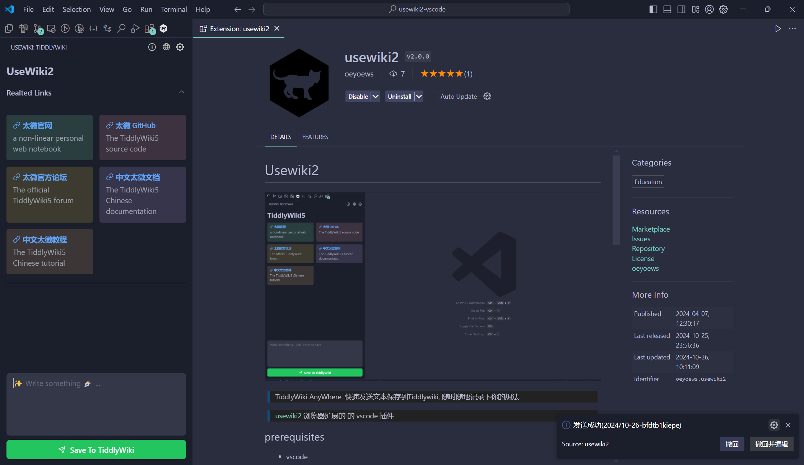

# Usewiki2



> TiddlyWiki AnyWhere. 快速发送文本保存到Tiddlywiki, 随时随地记录下你的想法.

> [usewiki2](https://github.com/oeyoews/usewiki2) 浏览器扩展的 的 vscode 插件

<video controls>
	<source src="https://github.com/oeyoews/usewiki2-vscode/raw/main/demo.mp4" type="video/mp4">
	<source src="demo.mp4" type="video/mp4">
</video>

<!--
* manage: https://marketplace.visualstudio.com/manage/publishers/oeyoews
* publish: https://vscode.github.net.cn/api/working-with-extensions/publishing-extension
* https://code.visualstudio.com/api/extension-guides/webview
* icon: https://code.visualstudio.com/api/references/icons-in-labels
* l10n: https://code.visualstudio.com/api/references/vscode-api#l10n and https://github.com/microsoft/vscode-extension-samples/tree/main/l10n-sample and https://github.com/microsoft/vscode-l10n/issues/150
-->

## prerequisites

- vscode

> [!WARNING]
> 你必须有一个可以在线或本地访问nodejs tiddlywiki实例.

## Features

- 快速发送文本到 TiddlyWiki
- 配置丰富
- 支持消息撤回编辑
- i18n 支持
- ...

## Install

- 直接在vscode 的扩展里面搜索 `usewiki2` 或者直接点击 [安装](https://marketplace.visualstudio.com/items?itemName=oeyoews.usewiki2) 即可

## Usage

- 点击 Activity Bar 的 usewiki 图标，用 **写新条目** 写内容，**Ctrl+Enter** 或状态栏 **保存到 TiddlyWiki**。
- 点击视图标题栏齿轮，先配置 TiddlyWiki 地址（`usewiki2.ip` / `usewiki2.port`）。

## Commands

<!-- commands -->

| Command                 | Title                         |
| ----------------------- | ----------------------------- |
| `usewiki2.wikiinfo`     | %usewiki2.tiddlywiki.title%   |
| `usewiki2.openwiki`     | %usewiki2.openwiki.title%     |
| `usewiki2.opensettings` | %usewiki2.opensettings.title% |
| `usewiki2.openComposer` | %usewiki2.openComposer.title% |
| `usewiki2.sendToWiki`   | %usewiki2.sendToWiki.title%   |
| `usewiki2.showHint`     | %usewiki2.showHint.title%     |

<!-- commands -->

## Configurations

<!-- configs -->

| Key                        | Description                                                                                                   | Type      | Default                                   |
| -------------------------- | ------------------------------------------------------------------------------------------------------------- | --------- | ----------------------------------------- |
| `usewiki2.placeholder`     | 默认提示符                                                                                                    | `string`  | `"Write something... Ctrl+Enter to save"` |
| `usewiki2.defaultTag`      | 默认标签                                                                                                      | `string`  | `"Journal"`                               |
| `usewiki2.defaultUsername` | 默认用户名                                                                                                    | `string`  | `""`                                      |
| `usewiki2.ip`              | 你的TiddlyWiki地址 (请确定你已经启动了[太微](https://tiddlywiki.com/#Installing%20TiddlyWiki%20on%20Node.js)) | `string`  | `"127.0.0.1"`                             |
| `usewiki2.port`            | 端口 (请确定你已经启动了太微)                                                                                 | `number`  | `8080`                                    |
| `usewiki2.enableHttps`     | Enable or Disable HTTPS(untest for https)                                                                     | `boolean` | `false`                                   |
| `usewiki2.type`            | 选择要使用的文本格式 (Markdown 或 TiddlyWiki)                                                                 | `string`  | `"text/vnd.tiddlywiki"`                   |

<!-- ## TODO

* [ ] 加入条目标题配置, author
* [x] use vue/react framework to refactor usewiki2 -->

## For Dev

```bash
pnpm install
pnpm run build          # 或 pnpm run dev（watch）
```

**F5**：选 **Extension (Run)**，在 `[Extension Development Host]` 中打开 usewiki 侧栏。

**命令行启动开发宿主**（无需先点 F5）：

```bash
# 在仓库根目录
cursor --new-window --extensionDevelopmentPath="$(pwd)" --disable-extensions
# 或: code --new-window --extensionDevelopmentPath="$(pwd)" --disable-extensions
```

改 `src/` 时保持 `pnpm run dev` 运行，或改完后 `pnpm run build` 并在开发窗口 **Ctrl+Shift+F5** 重载。

<!-- * configuration: https://code.visualstudio.com/api/references/contribution-points#contributes.configuration -->

<!-- ## Credits

https://github.com/microsoft/vscode-extension-samples/blob/main/webview-view-sample -->

## Related Projects

- [usewiki2](https://github.com/oeyoews/usewiki2)
- [other tiddlywiki projects](https://github.com/stars/oeyoews/lists/tiddlywiki)
